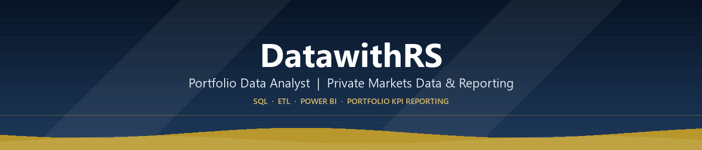

<table align="center">
<tr>
<td width="160" align="center">

</td>
<td>

</td>
</tr>
</table>

  
  
  
  
  
  
  
  

  
  
  
  
  
  
  
  

  
  

### 👋 About me

- 💼 Portfolio Data Analyst focused on **private markets & portfolio performance reporting** — tracked 15–20 KPIs across 10+ partner programs
- 🧰 Full-stack reporting pipeline: **SQL (joins, aggregation, reconciliation) → ETL → Power BI / DAX** management dashboards
- ✅ Reconciled partner-reported figures against source records with SQL validation queries, improving data reliability by **25%**
- ⚙️ Automated recurring reporting with Python, Excel VBA and reusable SQL — cut manual preparation effort by **30–40%**
- 🎓 MSc Data Analytics (Big Data, Statistical Modeling, Machine Learning, SQL & Database Management) — Berlin School of Business & Innovation, 2026
- 🧪 Also building experimentation & ML depth: pre-registered A/B tests, power analysis, churn models, CNN-based image classification — see [kyc-onboarding-ab-test](https://github.com/DatawithRS/kyc-onboarding-ab-test)
- 🌍 Domain focus: **private equity, private capital markets, corporate finance, financial statements**
- 💬 Ask me about SQL reconciliation, Power BI/DAX data models, ETL workflows, or portfolio KPI reporting
- 📌 Every repo below is a real, self-contained project — not a tutorial clone

---

### 📌 Featured projects

**🧪 [kyc-onboarding-ab-test](https://github.com/DatawithRS/kyc-onboarding-ab-test)** — A/B test: redesigned KYC onboarding flow

 Pre-registered hypothesis and decision rule, power analysis, a simulated A/A test proving the significance test is actually calibrated (not just trusted on faith), CUPED variance reduction, Benjamini-Hochberg correction across the primary/guardrail/segment tests, a guardrail trade-off, and a €/year business-impact estimate — with CI that regenerates the data and re-runs the whole analysis on every push.
 `Python` `Statistics` `A/B Testing` `pytest` `GitHub Actions`

<table>
<tr>
<td width="50%" valign="top">

**[PowerBI-Sales-Analytics](https://github.com/DatawithRS/PowerBI-Sales-Analytics)**
 E-commerce sales analytics dashboard with customer/product/order data modeling
 `Power BI` `DAX`

</td>
<td width="50%" valign="top">

**[superstore-sales-dashboard-powerbi](https://github.com/DatawithRS/superstore-sales-dashboard-powerbi)**
 Retail sales dashboard on the classic Superstore dataset
 `Power BI` `DAX`

</td>
</tr>
</table>

| Project | What it does | Stack |
|---|---|---|
| [multichannel-ecommerce-analytics](https://github.com/DatawithRS/multichannel-ecommerce-analytics) | End-to-end commercial analytics across 5 channels & 14 tables — SQL, Python (RFM, cohorts), Power BI | `SQL` `Python` `Power BI` |
| [kyc-onboarding-ab-test](https://github.com/DatawithRS/kyc-onboarding-ab-test) | A/B test on a redesigned KYC onboarding flow — pre-registered, power-checked, calibration-proven, CUPED, CI-verified | `Python` `Statistics` `A/B Testing` `pytest` |
| [applied-ml-notebooks](https://github.com/DatawithRS/applied-ml-notebooks) | Telco customer churn analysis + plant leaf disease image classification | `Python` `TensorFlow` `ML` |
| [pneumonia-detection-cv](https://github.com/DatawithRS/pneumonia-detection-cv) | CNN classifying chest X-rays as Normal vs. Pneumonia (Keras/TensorFlow) | `Deep Learning` `Computer Vision` |
| [Clustered-HR-Data](https://github.com/DatawithRS/Clustered-HR-Data) | HR analytics dashboard tracking attrition, promotion & retrenchment risk | `Power BI` `DAX` |
| [mumbai-smart-city-energy-analysis](https://github.com/DatawithRS/mumbai-smart-city-energy-analysis) | MSc dissertation: 101-respondent survey on household energy behavior in Mumbai — descriptive stats, correlation analysis, smart-city policy recommendations | `Statistics` `Survey Research` `Python` |

---

